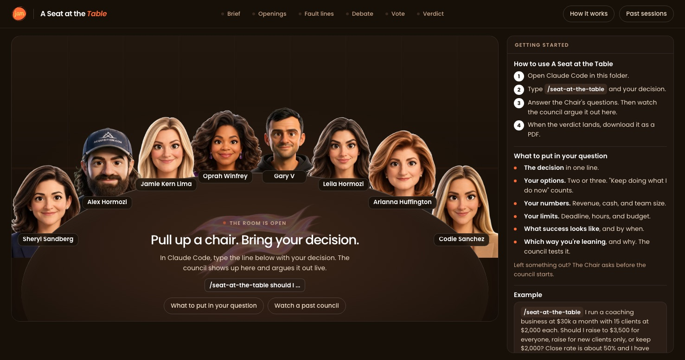

# A Seat at the Table



Bring a hard business decision and eight AI advisors argue it out, then hand you a scored verdict and a one-click PDF. Six of the eight seats belong to women who built big things: Sheryl Sandberg, Oprah Winfrey, Jamie Kern Lima, Arianna Huffington, Leila Hormozi, and Codie Sanchez. Alex Hormozi and Gary Vaynerchuk keep their chairs. Each seat is built from that person's public talks, interviews, and keynotes. The council runs in Claude Code, and a small local web app shows them around a table talking it through.

This is a remix of Nate Herk's [Roast Room](https://github.com/nateherkai/roast-room), which is MIT licensed. Nate built the engine. I noticed his board was all dudes, so I pulled up more chairs. 🧡 Jam

| Seat | Pillar | The question they own |
|---|---|---|
| Sheryl Sandberg | Strategy and scale | Is this the right bet, and can it scale? |
| Alex Hormozi | Offers, pricing, and sales | Will people pay, how much, and how do we close? |
| Jamie Kern Lima | Product and customers | Do customers truly want this, and will you bet on yourself? |
| Oprah Winfrey | Audience, trust, and purpose | Does this serve your people, and is it true to who you are? |
| Gary Vaynerchuk | Marketing and attention | Where does the attention come from, and is it underpriced? |
| Leila Hormozi | Operations, hiring, and team | Who runs this, and can the team carry it without you? |
| Arianna Huffington | Founder energy and sustainability | What will this cost your energy, health, and focus? |
| Codie Sanchez | Money, cash flow, and ownership | What does it do to cash, risk, and what you own? |

Why a founder energy seat? Most boards never ask whether the founder can survive the plan. Arianna's seat does, every time.

## What you need

- [Claude Code](https://claude.com/claude-code). Your Claude plan covers it; no API key needed.
- [Node.js](https://nodejs.org) 20 or newer, for the room. There's nothing else to install.

## Setup

```bash
git clone https://github.com/JamoutAi/seat-at-the-table.git
cd seat-at-the-table
```

Or open Claude Code anywhere and say: "Clone github.com/JamoutAi/seat-at-the-table and start the room for me."

## Run a council

1. Start the room: `npm start`, then open http://localhost:4730. Leave it open.
2. Open Claude Code in the same folder: `claude`
3. Type `/seat-at-the-table` and your decision.
4. Answer the Chair's questions, then watch the board argue it out in the room.
5. When the verdict lands, click **Download PDF**.

You also get a short verdict in Claude Code, and the full report lands in `sessions/<date>-<decision>/verdict.md`.

## What to put in your question

The board is only as good as what you give it. Include:

- **The decision** in one line.
- **Your options.** Two or three. "Keep doing what I do now" counts.
- **Your numbers.** Revenue, cash, and team size.
- **Your limits.** Deadline, hours, budget, and honestly, your energy.
- **What success looks like**, and by when.
- **Which way you're leaning**, and why. The board tests your lean instead of agreeing with it.

Left something out? The Chair asks before the council starts. Example:

```
/seat-at-the-table I run a coaching business at $30k a month with 15 clients at $2,000 each.
Should I raise to $3,500 for everyone, raise for new clients only, or keep $2,000?
Close rate is about 50% and I have $40k in the bank. Success is $45k a month by March.
I'm leaning toward raising for everyone because I'm underpaid.
```

More ways to run it:

- `/seat-at-the-table --quick ...` seats four advisors for two rounds. Use it for smaller, reversible calls. It uses far less of your plan.
- `/seat-at-the-table --seats oprah,codie ...` seats only the advisors you name.
- `/seat-at-the-table ask oprah ...` gets one answer from one seat.

The room is optional. The council runs the same in Claude Code without it.

## Watch an example first

Run `npm start`, open http://localhost:4730, and click **Past sessions**. A finished council ships with the repo, so you can see how it works (and download its PDF) before you run your own.

## How it works

- **The council runs in Claude Code.** Each seat is a sub-agent (`.claude/agents/council-*.md`) that reads its own brain (`.claude/skills/seat-at-the-table/brains/<name>/`): frameworks, principles, positions, stories, and voice notes compiled from public sources, with every quote tied to a source. Claude Code acts as the Chair. It runs the rounds, keeps score, and writes the verdict (`.claude/skills/seat-at-the-table/SKILL.md`).
- **Each seat scores every option**, weighted by how much that seat's pillar matters to your decision. The Chair caps the verdict when a seat flags ruin risk, and it forces a real argument when everyone agrees too fast.
- **The room only watches.** As the Chair works, it writes each step to `sessions/`, and the app plays those files back. The room makes no AI calls of its own.
- **Every council is saved** in `sessions/`. Past sessions replays any of them and downloads its PDF.
- **Usage:** a full council is 24 sub-agent runs, so it takes a real bite out of your plan's usage. Use `--quick` for small calls.

## Optional: let the room run councils itself

If you'd rather type a decision straight into the room, copy `.env.example` to `.env`, add an `ANTHROPIC_API_KEY`, set `COUNCIL_RUNNER=api`, and restart `npm start`. That mode bills your Anthropic API account (about 28 calls per full council).

## What's inside

| Path | What |
|---|---|
| `.claude/skills/seat-at-the-table/` | The skill: protocol, prompts, scoring, report template, and the eight brains |
| `.claude/agents/` | The eight seat agents |
| `app/` | The room: a zero-dependency Node server, the web page, and the PDF builder |
| `sessions/` | Your councils (kept out of git) and the example |

## About the advisors

These are simulations built from each person's public work. They are not the people, they don't speak for them, and none of them is affiliated with or endorses this project. The portraits are caricatures. A seat only quotes a person verbatim when the line is in its brain with a source, and `python .claude/skills/seat-at-the-table/scripts/check_quotes.py sessions/<session>` checks every quote in a council against the brains. Each brain's `sources.md` lists the videos it was built from.

## Credits

- The engine, room, scoring, and the Alex Hormozi and Gary Vaynerchuk brains and portraits: Nate Herk and AI Automation Society, [Roast Room](https://github.com/nateherkai/roast-room), MIT.
- The six new seats, their brains and portraits, the Jam AI design, and the founder energy pillar: Robyn "Jam" Anderson, [Jam AI](https://jamout.ai).
- The PDF builder bundles [jsPDF](https://github.com/parallax/jsPDF) (MIT) and [Poppins](https://github.com/itfoundry/Poppins) (SIL Open Font License); their licenses sit next to them in `app/public/`.

Want to learn to build things like this with AI? Come hang out in [Club Jam on Skool](https://www.skool.com/jamoutai). 🧡
